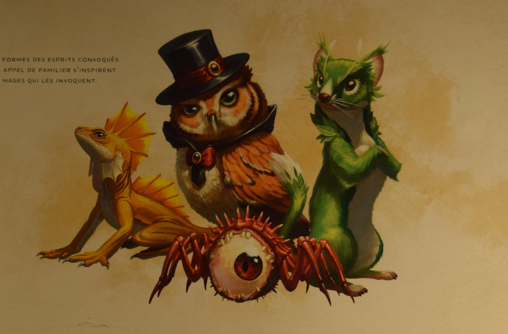

# Appel de familier

Vous recevez les services d'un familier, esprit qui prend la forme animale de votre choix : **araignée, belette, chat, chauve-souris, chouette, corbeau, faucon, grenouille, lézard, pieuvre, rat** ou autre Bête dont le facteur de puissance est de 0. Le familier se présente en un espace inoccupé à portée, avec le profil de jeu de la forme retenue (cf. annexe B), si ce n'est qu'il s'agit d'un Céleste, d'une Fée ou d'un Fiélon (à votre convenance) et non d'une Bête. Votre familier agit indépendamment de vous, mais il obéit à vos instructions.

**Lien télépathique.** Tant que votre familier se trouve dans un rayon de 30 m de vous, vous pouvez communiquer avec lui par télépathie. De plus, par une action Bonus, vous pouvez voir par ses yeux et entendre par son ouïe jusqu'au début de votre tour suivant, en bénéficiant de ses éventuels sens spéciaux.

Enfin, si vous lancez un sort dont la portée est « contact », votre familier peut appliquer ce contact. Il doit se trouver dans un rayon de 30 m de vous et doit jouer sa Réaction pour appliquer le contact lors de l'incantation.

**Combat.** Le familier est votre allié, ainsi que celui de vos alliés. Il joue sa propre Initiative et agit à son tour. Un familier ne peut pas attaquer, mais il peut entreprendre normalement d'autres actions.

**Disparition du familier.** Quand le familier tombe à 0 point de vie, il disparaît. Il réapparaît si vous relancez ce sort. Au prix de l'action Magie, vous pouvez provisoirement révoquer le familier dans une niche dimensionnelle. Vous pouvez également le révoquer à tout jamais. Au prix de l'action Magie, tant qu'il est provisoirement révoqué, vous pouvez le faire réapparaître en un espace inoccupé dans un rayon de 9 m de vous. Quand le familier tombe à 0 point de vie ou disparaît dans une niche dimensionnelle, il laisse tout ce qu'il porte sur lui dans son espace.

**Un seul familier.** Vous ne pouvez pas disposer de plus d'un familier à la fois. Si vous lancez ce sort alors que vous disposez déjà d'un familier, ce dernier adopte en fait une nouvelle forme adaptée.

## Illustration associée (distincte du texte du sort)

*Les formes des esprits convoqués par Appel de familier s'inspirent des mages qui les invoquent.*
