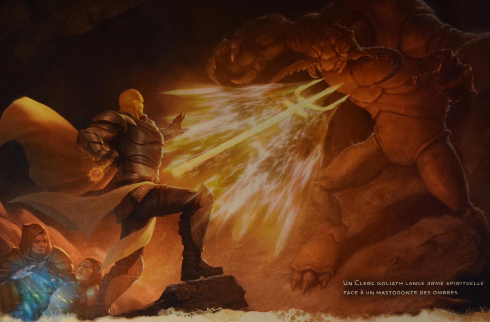

# Arme spirituelle

Vous créez une arme spectrale et flottante à l'image de l'arme de votre choix, qui persiste pour toute la durée. L'arme apparaît à portée dans l'espace de votre choix et vous pouvez aussitôt effectuer une attaque de sort au corps à corps contre une créature située dans un rayon de 1,50 m de l'arme. Si l'attaque touche, la cible subit des dégâts de force égaux à 1d8 + votre modificateur de caractéristique d'incantation.

Par une action Bonus à chaque tour consécutif, vous pouvez déplacer l'arme d'un maximum de 6 m et répéter l'attaque contre une créature située dans un rayon de 1,50 m de l'arme.

**Emplacement de niveau supérieur.** Les dégâts augmentent de 1d8 par niveau d'emplacement au-delà du 2e.

## Illustration associée (distincte du texte du sort)

*Un clerc goliath lance arme spirituelle face à un mastodonte des ombres.*
