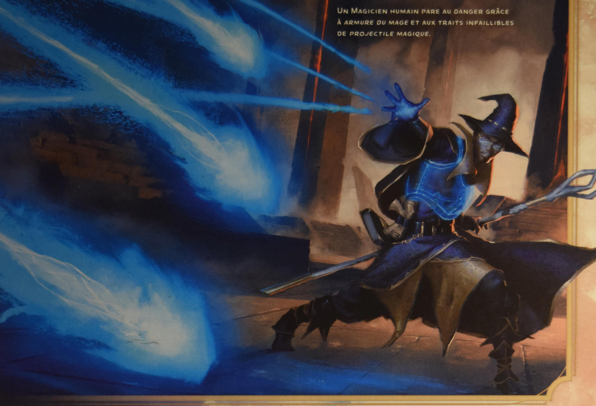

# Armure du mage

Vous touchez une créature consentante qui ne porte pas d'armure. Jusqu'à la fin du sort, sa CA de base est de 13 plus son modificateur de Dextérité. Le sort prend fin prématurément si la cible enfile une armure.

## Illustration associée (distincte du texte du sort)

*Un magicien humain pare au danger grâce à armure du mage et aux traits infaillibles de projectile magique.*
